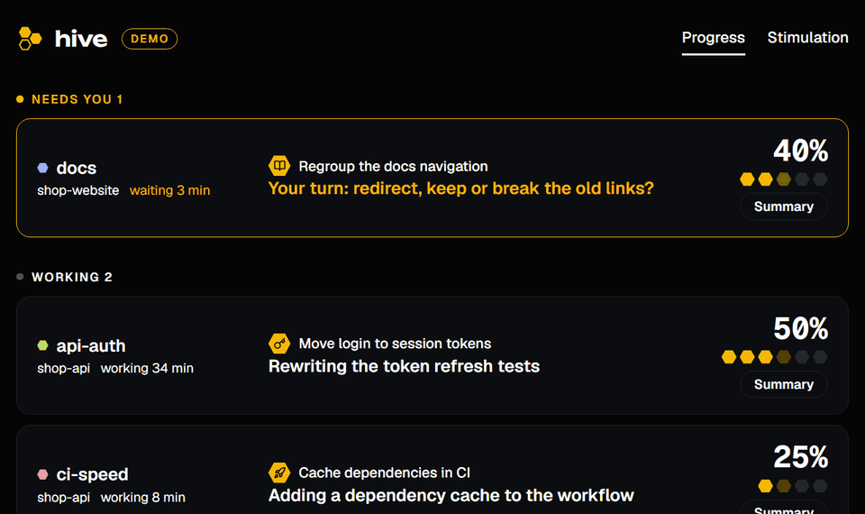
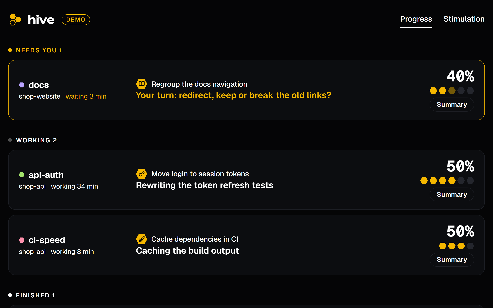
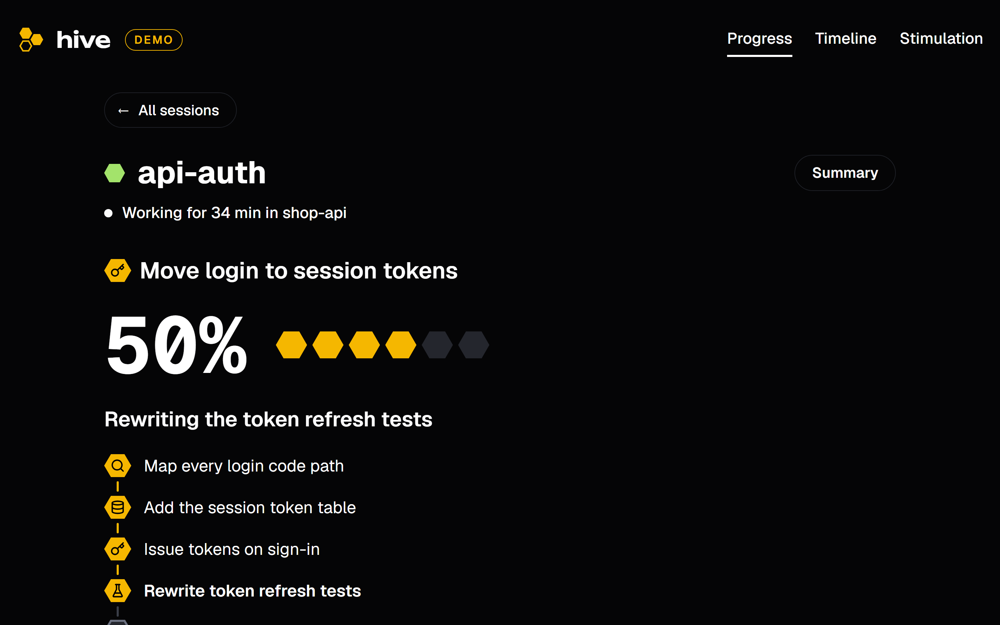
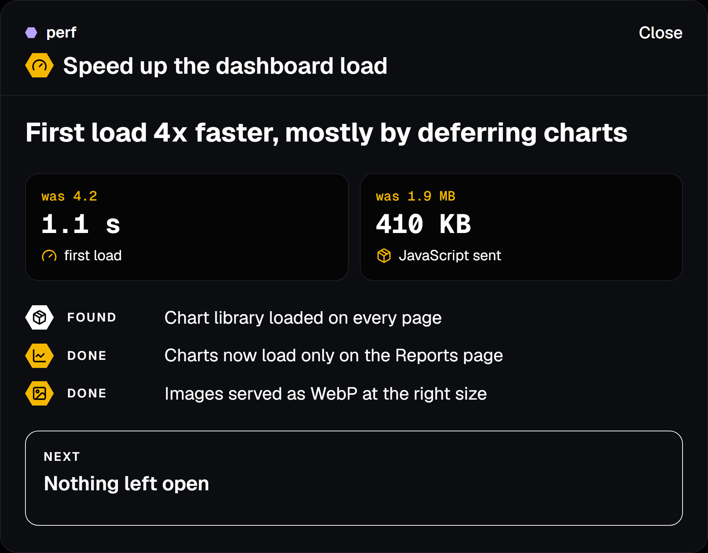
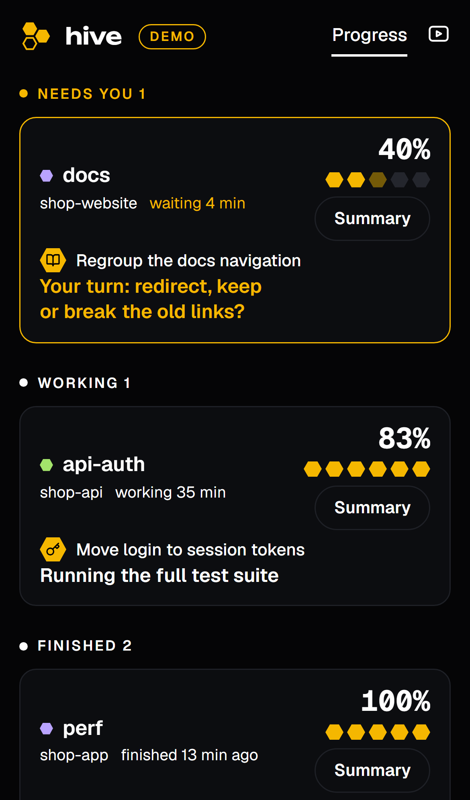
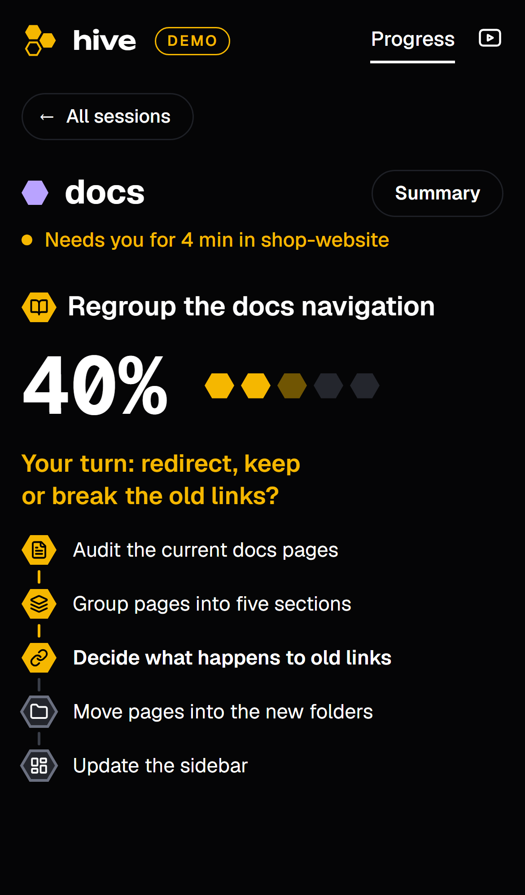
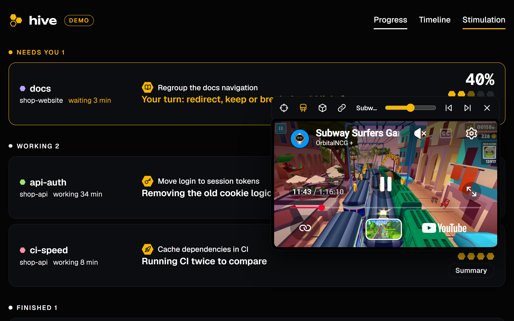
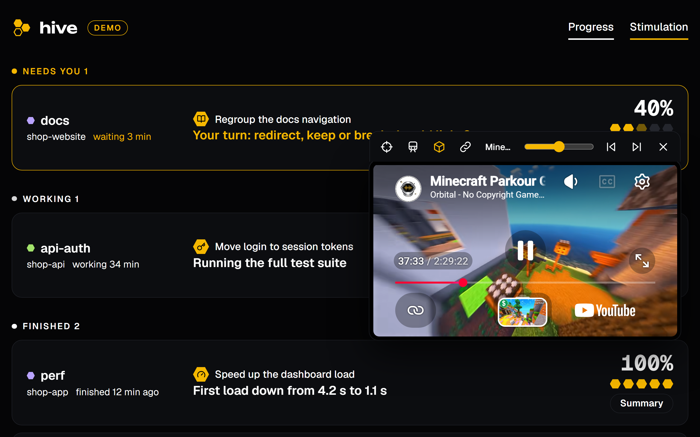

<p align="center">
  <picture>
    <source media="(prefers-color-scheme: dark)" srcset="docs/brand/wordmark/on-dark.png">
    
  </picture>
</p>

<p align="center">
  A live board for every Claude Code session on your machine: where each one stands, what it needs from you, and what it said, without the tool calls.
</p>

<p align="center">
  <a href="LICENSE"></a>
  
  
  
  <a href="https://github.com/AmmarSaleh50/hive/actions/workflows/ci.yml"></a>
</p>

---

<p align="center">
  
</p>

## Why

I often run eight Claude Code sessions at once. Each one writes useful things between its tool calls ("found the bug, it's the cache key", "tests pass, one question for you"), and those lines get buried under hundreds of tool calls. To find out where a session stands I had to scroll through its whole terminal. With eight of them I lost track of which one was waiting on me.

Hive is one page that answers that at a glance.

## What you get

**A board, grouped by what matters.** Sessions that **need you** (a question, an approval, something to test) come first, then the ones still **working**, then the **finished** ones. Each row shows what the session is working on, one line saying what it's doing right now, and its progress as a strip of honeycomb cells.

<p align="center"></p>

**Progress you can trust.** A small, cheap model (Claude Haiku) reads each session's recent messages and keeps a step list: what's done, what's happening now, what's left. Finished steps stay finished. When you give a session something new, the old job moves to "Earlier in this session" with its own summary.

<p align="center"></p>

**What it said, without the tool calls.** Under its steps, each session page lists what the session said to you, grouped by what you asked. Short "now doing X" lines stay on one line, results show in full, and questions and plans it put to you are included.

**A briefing instead of a wall of text.** One headline, the numbers that matter (before → after), a few tagged facts and one box that says what's next or what's your move.

<p align="center"></p>

**On your phone too.** Hive works as a home-screen app, privately over [Tailscale](https://tailscale.com).

<p align="center">
  
  &nbsp;&nbsp;
  
</p>

**Stimulation, if you need it.** Waiting on eight agents is boring, and boredom is how you end up in another tab. Press **Stimulation** for a floating player you can drag anywhere and resize to any shape: **Subway Surfers** and **Minecraft parkour** gameplay built in (each starts at a random point), **your own clips** from any folder, and **any YouTube video or Twitch stream** (type `ttv/channel`). Its controls sit above the video, never on top of the board or the player's own buttons.

<p align="center">
  
  &nbsp;
  
</p>

## Try it

You need [Node.js 18+](https://nodejs.org). Nothing to install.

```bash
git clone https://github.com/AmmarSaleh50/hive
cd hive
npm run demo        # made-up sessions that play out by themselves
```

Open <http://localhost:4747>.

## Use it with your sessions

You also need [Claude Code](https://code.claude.com) installed and signed in, because Hive uses your `claude` command for the progress summaries.

```bash
npm start
```

Open <http://localhost:4747>, then start or keep using Claude Code as usual. Sessions appear on their own.

**Start it with your computer** (optional):

- **Windows:** `powershell -ExecutionPolicy Bypass -File scripts\autostart-windows.ps1` (add `-Remove` to undo)
- **macOS / Linux:** run `node /path/to/hive/server.cjs` from a launchd agent or a systemd user service.

**Type `hive.localhost` instead of the port:** add `"extraPorts": [80]` to your settings (see below). On Windows that works as is; on macOS and Linux port 80 needs extra privileges.

## Open it from your phone (Tailscale)

Hive only ever listens on `localhost`, so nothing on your network can reach it. To use it from your phone, publish it on your private tailnet:

```bash
tailscale serve --bg --https=443 http://127.0.0.1:4747
```

Now `https://<this-computer>.<your-tailnet>.ts.net` opens Hive on any device signed in to your Tailscale, and nowhere else. Hive accepts that name by itself. On your phone, use "Add to Home Screen" to get it as an app. To stop sharing: `tailscale serve --https=443 off`.

## How it works

```
~/.claude/sessions/*.json   which sessions are running, and whether they're busy, idle or waiting on you
~/.claude/projects/**.jsonl each session's transcript (Hive reads only new lines, and only the text)
~/.claude/tasks/<id>/       the session's own task list, if it keeps one
            │
            ▼
        server.cjs ──── recent messages ───▶ claude -p --model haiku   (goal, steps, now-line, briefing)
            │
            ▼
   http://localhost:4747   one page, live updates over server-sent events
```

- **Read-only.** Hive never writes inside `~/.claude`.
- **Summaries only when useful.** Every 12 seconds per session at most while the board is open, every 5 minutes while it's closed, and right away when a session changes state. Each update is one short `claude -p` run with no tools, no settings and nothing saved.
- **Its own files** live in `data/`: a cache of the progress it has worked out, and a log of the tokens each Haiku run used.

## Settings

Copy `hive.config.example.json` to `hive.config.json` and change what you need. Everything is optional.

| Setting | Default | What it does |
|---|---|---|
| `port` | `4747` | Port on `localhost` |
| `extraPorts` | `[]` | More ports, e.g. `[80]` for `http://hive.localhost` |
| `claudeDir` | `~/.claude` | Where Claude Code keeps its sessions |
| `claudeBin` | found by itself | Path to the `claude` command |
| `summaries.enabled` | `true` | Turn the Haiku summaries off |
| `summaries.model` | `haiku` | Model used for summaries |
| `summaries.openEverySeconds` | `12` | Fastest update rate per session while the board is open |
| `summaries.backgroundEverySeconds` | `300` | Update rate while no board is open |
| `closedHours` | `6` | How long closed sessions stay listed |
| `clips` | `[]` | Folders of your own videos for the player: `[{ "path": "~/Videos/Clips", "label": "Gameplay" }]` |
| `tailscale` | `true` | Accept this machine's Tailscale name |
| `dataDir` | `./data` | Where Hive keeps its own files |

## Privacy and cost

- **What leaves your machine:** only the summaries. The recent chat text of a session (never its tool calls or files) goes to Claude Haiku through your own `claude` login, the same way your sessions talk to Claude. Turn it off with `"summaries": { "enabled": false }`.
- **What it costs:** one update is about 9,000 tokens in and 1,300 out, roughly $0.0025 at API list prices. With a Claude subscription it counts toward your normal usage limits; next to an active Opus session it's around half a percent. `data/usage.jsonl` records every run so you can check.
- **Who can open it:** only you. Hive listens on loopback, refuses requests for any other host name (so other websites can't reach it), and is only visible to your other devices if you publish it with `tailscale serve`.

## Good to know

- Hive reads files Claude Code keeps for itself. They aren't a public API, so a Claude Code update can change them. If sessions stop showing up, please open an issue.
- Built and used daily on Windows 11 with Chrome. It's plain Node with no dependencies, so macOS and Linux should work. Reports are welcome.
- Twitch streams only play when Hive is opened over HTTPS (the Tailscale address), because Twitch refuses to embed on plain-HTTP pages.

## Contributing

Bug reports, ideas and pull requests are welcome. See [CONTRIBUTING.md](CONTRIBUTING.md). Security issues: [SECURITY.md](SECURITY.md).

## License

MIT, see [LICENSE](LICENSE).
